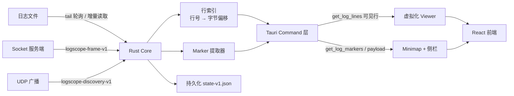

<p align="center">
  
</p>

<h1 align="center">LogScope</h1>

<p align="center">
  面向 Windows / macOS 的高性能、只读日志查看器<br/>
  50–100 MB 大文件不卡顿，实时流边收边看，协议消息一眼可见。
</p>

<p align="center">
  <a href="https://github.com/backkom/log_scope/actions/workflows/ci.yml"></a>
  <a href="https://github.com/backkom/log_scope/actions/workflows/release.yml"></a>
  
  <a href="LICENSE"></a>
</p>

---

## 背景：为什么需要另一个日志工具

这个项目来自真实的工作场景：调试一个 Unity 客户端 + 服务端联调的游戏，手上有几类日志——

- Unity 编辑器 / 打包客户端写出的纯文本日志，单文件经常 **50–100 MB**、几十万到上百万行；
- 客户端与服务端之间的协议消息，形如
  `13:05:42	========= Receive Message ([342] S_GET_CSVFILE_RESULT) =========`，
  后面跟一大段 pretty-printed JSON；
- 穿插在日志里的单行 JSON 埋点事件、`ChangeState ... { ... }` 状态块、Lua `stack traceback:` 堆栈；
- 服务端还在持续写、或者通过 socket 实时推过来的**流式**日志。

用现成工具看这些日志，每一种都差一口气：

| 工具 | 卡在哪里 |
| --- | --- |
| VS Code / Sublime / Notepad++ | 把整份文件装进编辑器文档模型。100 MB 打开就要等，滚动掉帧，内存翻几倍；文件还在追加时无法优雅跟随 |
| `grep` / `less` / `tail -f` | 能搜能追，但只有文本，看不出哪几行是一条完整的协议消息，也没有全局分布概览 |
| Unity Console / 游戏内控制台 | 只保留最近若干行，历史回看无从谈起 |
| 通用日志平台（ELK 等） | 需要先把日志送上去，本地离线文件、内网 socket 直连的场景反而更麻烦 |

结论很直接：需要一个**只读的、为「大文件 + 实时流 + 结构化事件」专门设计**的查看器，而不是再给通用编辑器加插件。

## LogScope 解决什么问题

1. **大文件不卡。** 原始日志始终留在磁盘：Rust 侧只建立 `行号 → 字节偏移` 索引，前端只按可见范围请求文本，永不把完整文件塞进 DOM 或编辑器文档。
2. **实时流不打断阅读。** 文件以 `tail -f` 语义增量刷新，socket 数据边收边追加；只有打开「跟随 Tail」时才自动滚到末尾，否则只提示新增行数、保持你当前的阅读位置。
3. **语义可见。** 协议消息块、JSON 事件、错误堆栈、关键字被提取成 **marker**：左侧可浏览和过滤，右侧 minimap 用颜色和小圆点展示整份日志的分布，点一下就能跳到对应位置并展开 JSON。
4. **定位够快。** 编辑器级查找（Regex / 大小写 / 全字 / 循环 / 查找所有）、行号跳转、marker 列表与收藏，都在同一条热路径上。
5. **跨平台一致。** Windows 和 macOS 共用同一套 Rust 核心与前端实现，而不是两套壳。

## 核心功能

| 能力 | 说明 |
| --- | --- |
| 打开大文件 | UTF-8 / UTF-8 lossy 文本，按需 seek 读取，索引在后台线程构建并回报耗时 |
| Tail 跟随 | 轮询检测文件增长，只读取新增字节并增量更新行索引；截断 / 轮转后自动重建 |
| Socket 实时流 | 主动连接 TCP 服务端，按 `logscope-frame-v1` 解码，写入临时 session 文件后复用同一套查看链路 |
| 局域网自动发现 | 监听 `logscope-discovery-v1` UDP 广播，连接弹窗直接列出可用服务端 |
| 虚拟化 Viewer | 固定行高、可见行 + 少量 overscan、有界行缓存，快速滚动时先渲染占位行再回填 |
| 查找 | `Ctrl+F` 浮层、`F3` / `Shift+F3` 遍历、`Ctrl+G` 行号跳转；匹配高亮只作用于渲染窗口 |
| Marker 提取 | `Send/Receive Message` 消息块、单行 JSON 事件、`ChangeState` 块、Lua `stack traceback`、关键字（error/warn/…） |
| Marker 侧栏 | 按标题 / 消息名 / 类型搜索，按 kind 多选过滤，点击跳转并展开 JSON Tree |
| Minimap | 顶部全局 marker 条（整份日志分布）+ 右侧 8 视口局部 minimap（Canvas 绘制，可拖拽） |
| 日志着色 | 三态：完整着色 / 仅 severity / 关闭；单行最多处理前 4 KB，纯装饰、不影响主链路 |
| 规则配置 | 五类 extractor 可启停、可配色；区分「即时生效」与「需重新扫描」两类配置 |
| 本地持久化 | `state-v1.json` 保存最近文件 / 最近 socket / 收藏夹 / 低风险 UI 状态 |
| 性能自测 | 一键生成 5 种 profile 的 fixture，运行核心 benchmark，状态栏展示渲染耗时 |
| 大文件降级 | ≥100 MB 自动降为仅 severity 着色，≥300 MB 默认隐藏右侧 minimap，均可手动恢复 |

## 界面结构

```text
┌───────────────────────────────────────────────────────────────────┐
│ 工具栏   暂停/恢复 · 数据源 · 收藏 · 规则设置 · 着色 · 跟随 Tail   │
├───────────────┬───────────────────────────────────┬───────────────┤
│               │ ▏▏▏ 顶部全局 marker 条（整份日志） │               │
│  Marker 侧栏  ├───────────────────────────────────┤   右侧        │
│  搜索 / 过滤  │  行号 │ log 文本（虚拟化只读）     │   minimap     │
│  列表 / 详情  │       │                            │  （8 视口）   │
├───────────────┴───────────────────────────────────┴───────────────┤
│ 状态栏  文件大小 · 总行数 · 索引耗时 · 查找耗时 · marker 总数     │
└───────────────────────────────────────────────────────────────────┘
```

## 架构



**职责划分**

- **Rust core**：文件 tail、TCP socket、frame 解码、文本与换行规范化、行索引、marker 提取、搜索、持久化、有界内存与背压。
- **前端（React + TypeScript）**：虚拟化只读文本视口、行号 gutter、可见行着色、查找 UI、Canvas minimap、JSON viewer 与全部交互映射。
- **不跨层**：前端不持有完整日志，不做解析决策；解析永远发生在 Rust 侧。

**关键决策**

- 采用 **append-only** 数据模型，行索引是主数据，结构化事件只是旁路索引——任何解析失败的内容都继续作为普通行展示，不丢行、不阻塞 viewer。
- 不做通用文本编辑器：没有编辑、保存、语法高亮系统，只有日志需要的读取、查找、跳转和标记。
- 不把 Monaco / CodeMirror 当作大文件主文档承载方案。
- CudaText 只作参考（大文件降级、minimap 概念、查找体验），不作为产品基础。

更多设计取舍见 [docs/PROJECT_CONTEXT.md](docs/PROJECT_CONTEXT.md) 与 [docs/IMPLEMENTATION_PLAN.md](docs/IMPLEMENTATION_PLAN.md)。

## 数据来源

### 1. 文件 tail

打开本地文件后，应用按固定间隔调用 `refresh_log_file` 检查大小；文件增长时只读取新增字节并增量更新行索引，文件变小时按截断 / 轮转处理。

### 2. Socket 流

使用本项目定义的 length-prefixed 协议 `logscope-frame-v1`：

```text
┌────────────────┬──────────────────────────────┐
│ 4 字节 BE 长度  │ UTF-8 JSON payload           │
└────────────────┴──────────────────────────────┘
```

payload 必须包含 `version: 1` 与 `recordType`：

| `recordType` | 字段 | 说明 |
| --- | --- | --- |
| `log.batch` | `records: [{ "text": "..." }]` | 一批可追加文本，末尾缺换行会自动补齐 |
| `log.text` | `payload: "..."` | 简单文本 frame |

单 frame 上限 8 MB。

仓库自带本地测试服务端，会持续发送随机日志并定期伪造 JSON marker 与 `Send/Receive Message` 块：

```bash
python3 scripts/logscope_socket_server.py --host 127.0.0.1
```

Unity 侧发送端参考实现见 [scripts/LogSender.cs](scripts/LogSender.cs)。

### 3. 局域网自动发现

服务端每 3 秒向 UDP `9876` 广播 `logscope-discovery-v1`（`protocol` / `host` / `port` / `hostname`），客户端在连接弹窗打开期间监听并列出可用服务端。

## 快速开始

### 环境要求

- **Node.js** 18+（推荐 20）与 **Yarn 1.22**
- **Rust** stable（建议 1.77+）
- **Tauri 2 平台依赖**
  - Windows：Microsoft C++ Build Tools + WebView2 Runtime
  - macOS：Xcode Command Line Tools（`xcode-select --install`）

### 开发

```bash
yarn install
yarn tauri:dev
```

VS Code 用户可直接使用 `.vscode/launch.json` 中的 `Tauri Dev: log_scope` 配置。

### 常用检查

```bash
yarn checktsc                                   # 前端类型检查
cargo check --manifest-path src-tauri/Cargo.toml # Rust 编译检查
```

### 本地打包

```bash
# macOS：生成 .app 与 .dmg（未签名）
yarn run package:macos

# macOS 通用二进制（Apple Silicon + Intel）
yarn run package:macos -- --universal

# Windows：生成 NSIS + MSI 安装包（必须在 Windows 主机执行）
yarn run package:windows
```

产物位于 `src-tauri/target/release/bundle/`。需要 Apple 签名 / 公证时，先配置 Tauri 所需证书环境变量，再执行 `LOGSCOPE_SIGN=1 yarn run package:macos`。

## GitHub Actions：跨平台自动构建与发布

仓库内置两个工作流，推送后即可在 GitHub 上编译各平台产物。

### `ci.yml` — 提交检查

在 `push` / `pull_request` 时对 **Windows + macOS** 双平台执行：

1. 安装依赖（Yarn 1.22，`--frozen-lockfile`）
2. `yarn checktsc` 前端类型检查
3. `yarn build` 前端产物构建
4. `cargo check --locked` Rust 编译检查

### `release.yml` — 打标签即发布

推送 `v*` 标签（或手动触发工作流）后，自动：

- macOS 上构建 **universal**（`aarch64` + `x86_64`）的 `.app` 与 `.dmg`
- Windows 上构建 `NSIS` `.exe` 与 `.msi` 安装包
- 把安装包上传到对应的 GitHub Release

### 启用步骤

1. 在 GitHub 新建空仓库（不要勾选初始化 README），然后推送：

   ```bash
   git remote add github git@github.com:OWNER/log_scope.git
   git push -u github master    # 本地分支是 main 时改为 git push -u github main
   ```

2. 打开 **Settings → Actions → General → Workflow permissions**，选择 **Read and write permissions**（发布 Release 需要）。
3. 打标签并推送，触发发布：

   ```bash
   git tag v0.1.0
   git push github v0.1.0
   ```

4. 在 **Actions** 页面观察构建，完成后在 **Releases** 下载各平台安装包。

也可以不建 Release、只验证编译：在 **Actions** 里手动运行 `release.yml`，构建产物会以 artifact 形式保留。

> **关于签名**：默认产物未签名。macOS 首次打开会被 Gatekeeper 拦截，可右键「打开」，或执行
> `xattr -dr com.apple.quarantine /Applications/LogScope.app`。Windows 会触发 SmartScreen 提示，选择「仍要运行」。
> 如需正式签名，在仓库 Secrets 中配置 Apple 证书（`APPLE_CERTIFICATE` / `APPLE_CERTIFICATE_PASSWORD` /
> `APPLE_SIGNING_IDENTITY` / `APPLE_ID` / `APPLE_PASSWORD` / `APPLE_TEAM_ID`），并取消 `release.yml` 中签名相关注释。

## 性能与降级

| 场景 | 行为 |
| --- | --- |
| 打开 100 MB 文件 | 后台构建行索引，UI 不冻结；状态栏展示索引耗时 |
| ≥ 100 MB | 自动降为仅 severity 行级着色 |
| ≥ 300 MB | 默认隐藏右侧 minimap，可在状态栏手动恢复 |
| 快速滚动 | 先渲染行号与占位行，Rust 返回后逐行回填，不缓存完整文件 |
| 持续 append | 未开启跟随 Tail 时只更新总行数并提示新增行，不改变阅读位置 |

自测入口：数据源面板可生成 5 种 profile 的 fixture（`mixed` / `short-lines` / `long-lines` / `dense-markers` / `append-stream`），并运行核心 benchmark 得到索引、marker 扫描、搜索与可见行读取耗时。

## 项目结构

```text
log_scope/
├── src/                       # React + TypeScript 前端
│   ├── main.tsx               # 应用主体：viewer、minimap、查找、侧栏、设置
│   └── styles.css
├── src-tauri/                 # Tauri 2 应用外壳与 Rust core
│   ├── src/lib.rs             # 全部 Tauri command 与日志处理核心
│   ├── tauri.conf.json
│   └── icons/
├── scripts/
│   ├── logscope_socket_server.py   # 本地 socket 测试服务端（含 UDP 广播）
│   ├── LogSender.cs                # Unity 侧发送端参考实现
│   ├── package-macos.sh
│   └── package-windows.ps1
├── docs/
│   ├── PROJECT_CONTEXT.md     # 长期项目记忆（架构 / 约束 / 取舍）
│   └── IMPLEMENTATION_PLAN.md # 分阶段实现计划
├── .github/workflows/         # CI 与跨平台发布
└── AGENTS.md                  # AI / Agent 协作说明
```

## 文档

| 文档 | 内容 |
| --- | --- |
| [docs/PROJECT_CONTEXT.md](docs/PROJECT_CONTEXT.md) | 长期项目记忆：需求、架构决策、协议、实现约束 |
| [docs/IMPLEMENTATION_PLAN.md](docs/IMPLEMENTATION_PLAN.md) | 分阶段实现计划与交付切片 |
| [AGENTS.md](AGENTS.md) | AI agent 协作与文档维护规则 |

> 修改架构或行为时，请同步更新 `docs/PROJECT_CONTEXT.md`。

## 路线图

- [ ] Marker 索引增量扫描（高频 tail 场景不再全量重建）
- [ ] 搜索任务取消与流式分批返回，替代单次 command
- [ ] 渐进式索引与进度 / 取消 UI，覆盖 300 MB 以上文件
- [ ] Socket 连接状态事件、显式断开与自动重连
- [ ] 更完整的规则系统：正则起始模式、多级 severity、规则导入导出
- [ ] 签名与公证的正式发布流水线

## 贡献

1. Fork 并创建特性分支。
2. 提交前跑通 `yarn checktsc` 与 `cargo check --manifest-path src-tauri/Cargo.toml`。
3. 涉及架构或行为变化的改动，同步更新 `docs/PROJECT_CONTEXT.md`。
4. 提交 PR，描述动机、改动范围与验证方式。

## 许可证

[MIT](LICENSE)
